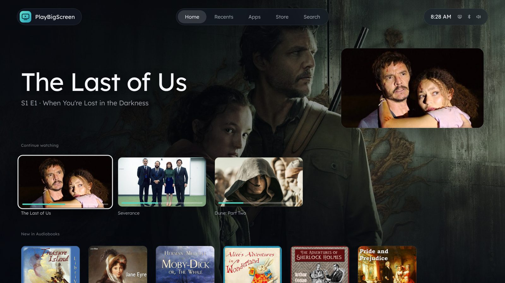

# PlayBigScreen

A home screen for TVs and big screens. Your Android apps and PlayBigScreen's own launcher
apps sit side by side on one row, the selected one fills the screen with its name and
background, and apps can add rows of their own, like **Continue watching** from
PlayTheater or **Continue playing** from RomM. It works with a TV remote, a keyboard, a
mouse or a touch screen, on any Android device.



- **Home**: the apps row, then rows from your apps. Hold OK (or press Menu) on an app to
  move it, take it off the row, give it its own background, open its settings or remove it.
- **Recents**, **Apps** (everything on the device, A to Z) and **Search** (apps by name, and
  what apps like PlayTheater and RomM find).
- **Store**: launcher apps and Android apps from repositories, with updates. Every file is
  checked against its checksum, and Android asks you to confirm each APK it installs.
- **Quick settings** from the clock: network, Bluetooth, volume, mute, and the device's own
  settings.
- **Settings**: accent colour, glass or flat panels, backgrounds (each app's own, or always
  the same), the order of the home rows, repositories, and setting PlayBigScreen as the
  home app.

## Launcher apps

Launcher apps are small web apps (HTML, CSS and JavaScript), like PlayTheater's plugins.
Each runs in its own sandbox, on its own origin, opens full screen or in a window, brings
its own icon, colour and background, and shows up next to the Android apps. Through the
SDK they can make web requests without CORS trouble, keep their own data, play video in the
device's player, open a web page full screen, and add rows and search results to the home
screen. The same apps will run on the Linux version. See [docs/APPS.md](docs/APPS.md).

The built-in repository has:

- **PlayTheater**: your PlayTheater server full screen, in its TV layout, with Continue
  watching and what's new on the home screen.
- **RomM**: the games on your RomM server by platform, with covers, played with RomM's
  own in-browser emulator.
- **PlayTheater for Android** (an APK), for the device's own player and downloads.

## Install

Download `PlayBigScreen-<version>.apk` from the [releases](https://github.com/MightyX3N/PlayBigScreen/releases)
and open it on the device (allow installs from your browser or file manager when Android
asks). Open PlayBigScreen, then press Home: Android asks which home app to use. On TVs that
don't ask, use a tool that turns off the TV's own launcher, or turn on the **Home button
helper** in Settings → This device. See [docs/ANDROID.md](docs/ANDROID.md).

## How it's made

The launcher is a web app (`ui/`, Svelte) in a thin native shell, so the same UI and the
same launcher apps run everywhere:

- `ui/` the launcher, `sdk/` the SDK launcher apps load.
- `android/` the Android shell (Kotlin): a WebView that serves the UI and apps from the APK
  and its storage, answers the UI's calls to the device ([docs/BRIDGE.md](docs/BRIDGE.md)),
  the device's video player, a full-screen web view, the APK installer and the Home helper.
- `host/` the same calls answered for a browser: used for developing and testing now, and
  the start of the Linux version.
- `repository/` the built-in repository ([docs/REPOSITORIES.md](docs/REPOSITORIES.md)).

To work on it:

```sh
cd ui && npm ci && npm run build && cd ..
node host/server.mjs            # http://localhost:8600/
sh tests/run.sh                 # browser tests (Playwright)
cd android && ./gradlew :app:testDebugUnitTest :app:assembleDebug
```

## Licence

GPL 3.0. The Lexend font is under the SIL Open Font Licence. RomM and PlayTheater are
separate projects; the apps here only talk to their servers.
